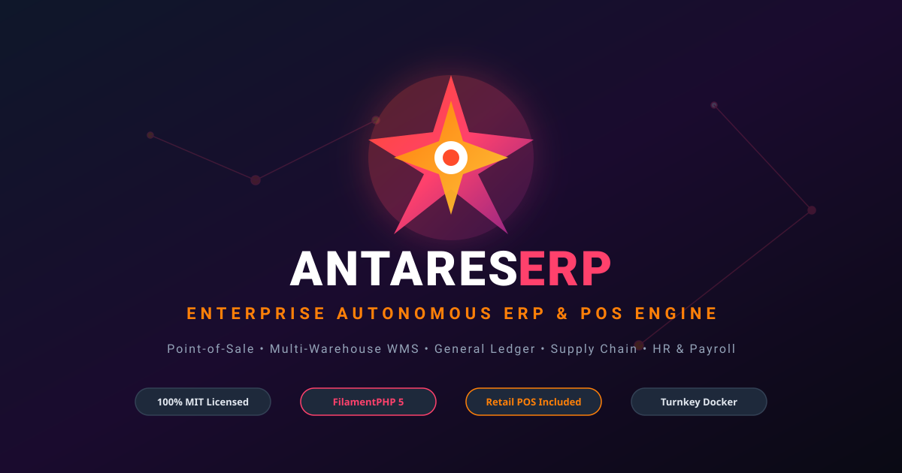

<p align="center">
  <picture>
    <source media="(prefers-color-scheme: dark)" srcset="public/brand/antares-banner.svg">
    <source media="(prefers-color-scheme: light)" srcset="public/brand/antares-banner.svg">
    
  </picture>
</p>

<p align="center">
  <a href="https://github.com/wtfear/AntaresERP/actions/workflows/ci.yml">
    
  </a>
  <a href="https://opensource.org/licenses/MIT">
    
  </a>
  <a href="https://laravel.com">
    
  </a>
  <a href="https://filamentphp.com">
    
  </a>
  <a href="https://docker.com">
    
  </a>
</p>

<h1 align="center">AntaresERP</h1>

<p align="center">
  <strong>Enterprise Autonomous ERP, Retail POS &amp; Multi-Warehouse Operations Engine</strong><br>
  <em>Engineered for Agencies, Retail Chains, Distributors, and Regulated Enterprises by WTFear Agency</em>
</p>

---

## 🏛️ Executive Summary

**AntaresERP** is an institutional-grade, 100% MIT-licensed Enterprise Resource Planning (ERP) and Point-of-Sale (POS) ecosystem built on modern **Laravel 13**, **FilamentPHP 5**, and **Tailwind CSS 4**. 

Unlike conventional SaaS ERPs (such as NetSuite, SAP Business One, or Odoo Enterprise) that penalize business growth with escalating per-user monthly seat licenses and vendor lock-in, AntaresERP delivers a completely sovereign, air-gapped operations engine. It unites physical retail checkout, multi-warehouse supply chains, automated purchasing, and double-entry general ledger accounting within a high-performance modular architecture.

### The Agency Commercial Advantage ($45k – $120k+ Engagements)
* **Zero SaaS License Taxes:** Deliver complete ERP ownership to clients without \$1,000s/month in recurring software license fees.
* **Turnkey Point-of-Sale (POS):** Deploy offline-capable cashier registers with barcode scanning, drawer kickouts, and automated receipt generation.
* **Real-Time Double-Entry Accounting:** Compliant general ledger, chart of accounts, tax engines, balance sheets, and automated P&L statements.
* **Modular Plugin Mesh:** Over 30 pre-integrated enterprise plugins managed natively via FilamentShield RBAC.

---

## ⚡ Core Operational Capabilities

```
                       ┌───────────────────────────────┐
                       │     ANTARES ERP CORE          │
                       │ (Laravel 13 + FilamentPHP 5)  │
                       └──────────────┬────────────────┘
                                      │
       ┌──────────────────┬───────────┴───────────┬──────────────────┐
       ▼                  ▼                       ▼                  ▼
┌──────────────┐   ┌──────────────┐        ┌──────────────┐   ┌──────────────┐
│  RETAIL POS  │   │ MULTI-WMS    │        │  ACCOUNTING  │   │  HRM & TEAM  │
│  • Registers │   │ • Bin Tracks │        │  • Ledger    │   │  • Payroll   │
│  • Barcodes  │   │ • Lots/Serial│        │  • P&L / Tax │   │  • Attendance│
│  • Offline   │   │ • Transfers  │        │  • Invoicing │   │  • Leaves    │
└──────────────┘   └──────────────┘        └──────────────┘   └──────────────┘
```

### 1. Point of Sale (POS) & Retail Terminal
* High-speed touchscreen-optimized cashier registers.
* Integrated barcode scanner support (`milon/barcode`).
* Cash drawer, thermal receipt printer, and multi-payment split tender support.
* Offline resilience with automatic transactional sync on reconnect.

### 2. Multi-Warehouse Inventory (WMS)
* Granular multi-warehouse bin, aisle, and rack location tracking.
* Batch numbers, lot tracking, expiration dates, and individual serial number tracing.
* Automated reorder triggers and inter-warehouse stock transfer workflows.
* Real-time valuation methods (FIFO, Moving Average, Standard Costing).

### 3. Financial Management & General Ledger
* Fully compliant double-entry journal entries and customizable Chart of Accounts (COA).
* Accounts Receivable (AR) and Accounts Payable (AP) matching.
* Multi-jurisdiction dynamic tax engines and fiscal year closure automation.
* Real-time balance sheets, profit & loss, cash flow, and trial balance reports.

### 4. Purchasing & Vendor Lifecycle
* Automated Request for Quotation (RFQ) distribution to verified suppliers.
* 3-Way matching: Purchase Order (PO) ↔ Goods Receipt Note (GRN) ↔ Vendor Invoice.
* Landed cost calculation (freight, duties, insurance allocated directly to inventory value).

### 5. Human Capital Management (HRM)
* Employee lifecycle management with organizational hierarchy mapping.
* Biometric device attendance integration and leave approval workflows.
* Automated payroll processing, deductions, and payslip generation.

---

## 📦 Architecture & Built-In Plugins

AntaresERP ships with an extensive modular plugin suite located in [`plugins/webkul`](file:///plugins/webkul):

| Plugin Module | Description |
| :--- | :--- |
| **`point-of-sale`** | Complete cashier registers, barcode scanning, POS sessions, and payment splits |
| **`inventories`** | Stock moves, warehouse bin locations, serial/batch tracking, adjustments |
| **`accounting`** | Chart of accounts, journal entries, trial balance, tax calculations |
| **`invoices`** | Client billing, automated PDF generation, credit notes, payment gateways |
| **`purchases`** | Supplier RFQs, purchase orders, vendor evaluation, bill reconciliation |
| **`sales`** | Sales orders, customer contracts, quotations, delivery notes |
| **`manufacturing`**| Bill of Materials (BOM), work orders, routing, and scrap management |
| **`employees`** | Staff directory, department hierarchies, contracts, and role access |
| **`time-off`** | Leave types, holiday calendars, automated accrual, approval matrices |
| **`security`** | FilamentShield granular role-based access control (RBAC) & audit trails |

---

## 🚀 Quick Start (Docker Compose)

The fastest way to deploy AntaresERP in production or local environments is via the included root `docker-compose.yml`:

### Prerequisites
* Docker 24.0+ and Docker Compose v2.20+
* Git

```bash
# 1. Clone repository
git clone https://github.com/wtfear/AntaresERP.git
cd AntaresERP

# 2. Configure environment
cp .env.example .env

# 3. Launch the complete stack
docker compose up -d
```

### Access Ports & Default Credentials
* **Web & Admin Portal:** [http://localhost:8080](http://localhost:8080)
* **Mailpit (Email Sandbox):** [http://localhost:8025](http://localhost:8025)
* **Default Admin User:** `admin@wtfear.agency`
* **Default Admin Password:** `antarespassword123`

---

## 🛠️ Local Development (Bare Metal / PHP 8.3+)

If running outside Docker:

```bash
# 1. Install Composer dependencies
composer install

# 2. Setup environment & key
cp .env.example .env
php artisan key:generate

# 3. Migrate and seed initial datasets
php artisan migrate --seed

# 4. Build frontend assets
npm install
npm run build

# 5. Start development server
php artisan serve --port=8080
```

---

## 🔒 Security & Data Sovereignty

* **FilamentShield Integration:** Fine-grained permissions per resource, action, and widget.
* **Air-Gapped Operation:** Capable of running in private VPCs with zero external internet dependencies.
* **Database Isolation:** Compatible with MySQL 8.0+ and PostgreSQL 16+.

---

## 📜 License

AntaresERP is completely open-source software released under the **[MIT License](LICENSE)**. You are free to modify, white-label, self-host, and deploy AntaresERP for commercial client engagements with zero royalties or per-seat fees.
